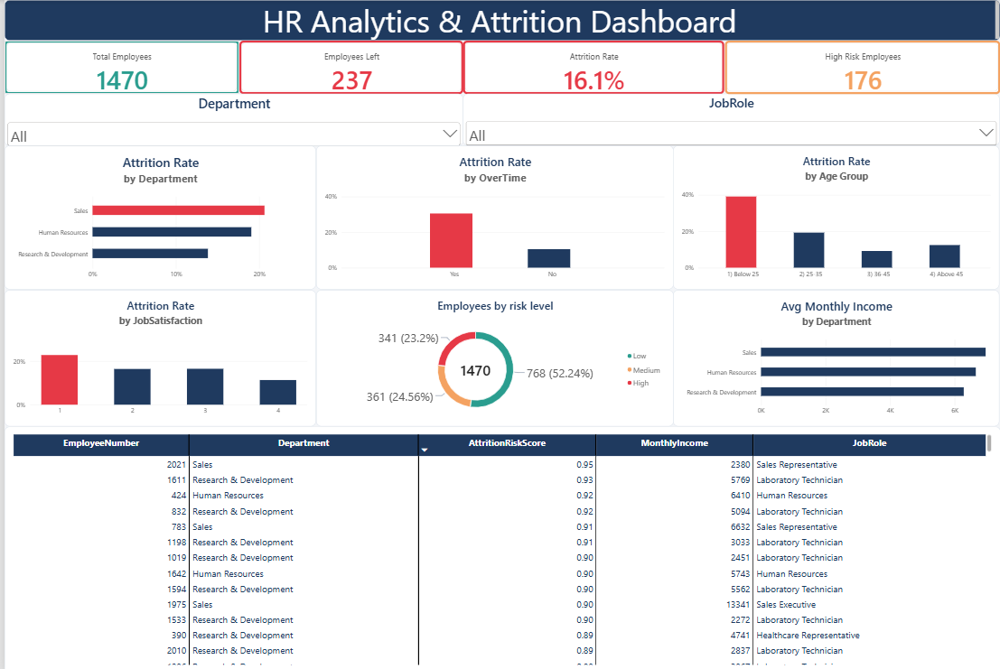

# HR Analytics & Employee Attrition Prediction

End-to-end HR analytics project using **SQL Server**, **Python** and **Power BI** to find out why employees leave, and to flag current employees who are at risk.



## Business questions
- How many employees have left, and what is the attrition rate?
- Which departments, roles and age groups lose the most people?
- Do overtime, salary and job satisfaction affect attrition?
- Can we predict which current employees are at risk of leaving?

## Tools
| Tool | Used for |
|---|---|
| SQL Server (SSMS) | Data validation and business analysis queries |
| Python (pandas, seaborn, scikit-learn) | Cleaning, EDA, and attrition prediction models |
| Power BI | Interactive HR dashboard with a risk-score table |

## Dataset
IBM HR Analytics Employee Attrition & Performance (Kaggle): 1,470 employees, 35 columns. This is a fictional dataset created by IBM data scientists.

## Project structure
```
HR_Analytics_Attrition/
├── Dataset/      IBM CSV and predictions CSV
├── SQL/          HR_Analysis.sql
├── Python/       HR_Attrition_Analysis.ipynb
├── PowerBI/      HR_Dashboard.pbix
├── Screenshots/  Dashboard and chart images
└── README.md
```

## Key findings

### SQL analysis
- **Overall attrition: 16.12%** (237 of 1,470 employees).
- **Overtime is the strongest driver:** 30.53% attrition for overtime employees vs 10.44% for others. Overtime staff are 28% of the workforce but 54% of all leavers.
- **Department:** Sales 20.63%, HR 19.05%, R&D 13.84%. (HR has only 63 employees, so treat that rate with caution.)
- **Job satisfaction:** attrition falls from 22.84% (lowest score) to 11.33% (highest score).
- **Salary:** leavers earned an average of 4,787 per month vs 6,832 for stayers, about 30% less.
- **Age:** employees under 25 left at 39.18%, compared with 19.30% (25-35), 9.19% (36-45) and 12.45% (above 45). The under-25 group is small (97 employees).

### Machine learning
Two models were trained on an 80/20 stratified split.

| Model | Accuracy | Recall (leavers) | Precision (leavers) | F1 (leavers) | ROC-AUC |
|---|---|---|---|---|---|
| Logistic Regression | 75.2% | **0.62** | 0.35 | **0.44** | **0.798** |
| Random Forest | 82.3% | 0.28 | 0.42 | 0.33 | 0.778 |

**Logistic Regression was selected.** Random Forest had higher accuracy but caught only 13 of 47 leavers in the test set. Because the business goal is to find at-risk employees, recall and F1 for leavers matter more than accuracy, so Logistic Regression was the better choice. It is also easier to explain to HR.

Every employee received an attrition risk score, grouped into Low, Medium and High (768 / 361 / 341 employees). **176 current employees** fall in the High group.

### Dashboard
- KPI cards: total employees, employees left, attrition rate, high-risk current employees
- Attrition by department, overtime, age group and job satisfaction
- Risk level breakdown and average income by department
- Table of high-risk current employees, sorted by risk score
- Department and job role slicers

## Limitations
- The findings show **association, not causation**. For example, overtime is strongly linked to attrition, but this data cannot prove it causes people to leave.
- Risk scores were produced with `class_weight="balanced"`, so they work as a **relative ranking**, not an exact probability.
- The scores were generated for all 1,470 employees, including the 80% used for training, so they look slightly better than they would on new employees. The model metrics above come from the held-out 20% test set.
- The dataset is fictional and fairly small.

## Possible next steps
- Tune the decision threshold and compare cost of false alarms vs missed leavers
- Cross-validation and hyperparameter tuning
- Add SHAP values for per-employee explanations
- Refresh the dashboard from a live SQL Server connection

## How to run
1. Run `SQL/HR_Analysis.sql` in SQL Server after importing the CSV as `HR_Employees`.
2. Open `Python/HR_Attrition_Analysis.ipynb` and run all cells (requires pandas, numpy, matplotlib, seaborn, scikit-learn).
3. Open `PowerBI/HR_Dashboard.pbix` in Power BI Desktop.

## Author
Aaryan Bhojane · [LinkedIn]www.linkedin.com/in/aryan-bhojane-420b25316 · [GitHub]https://github.com/aaryan2605
